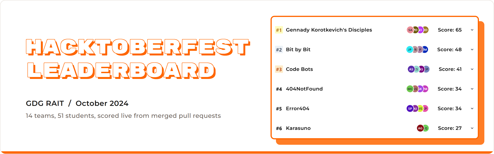
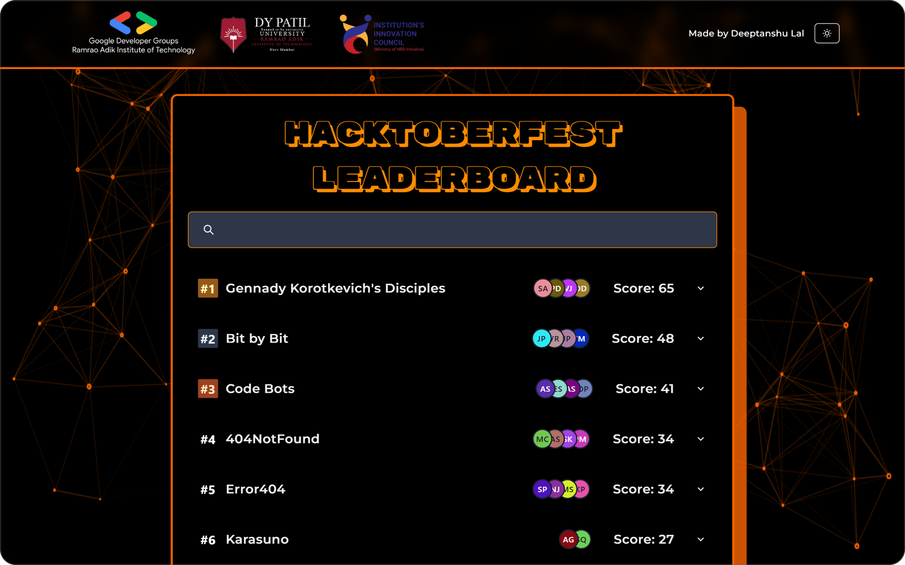
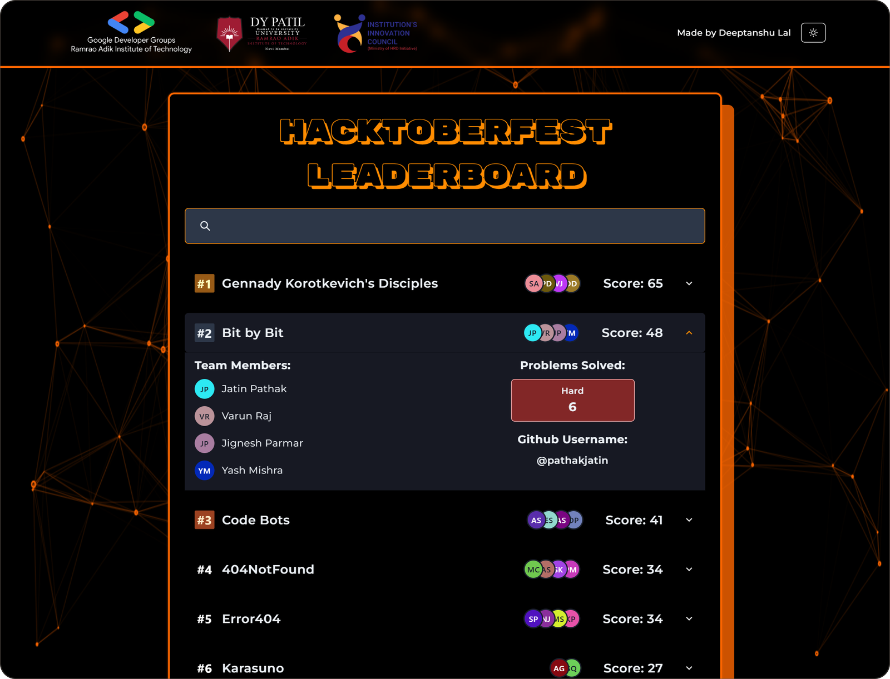
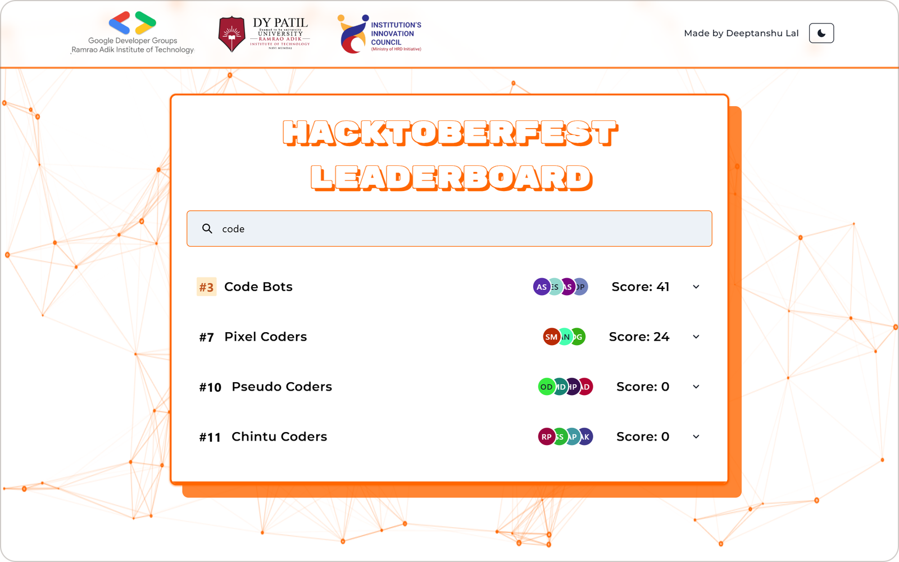
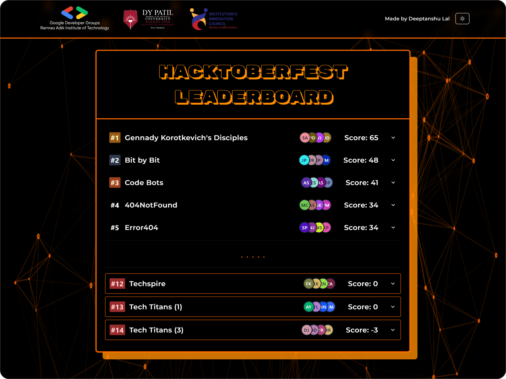
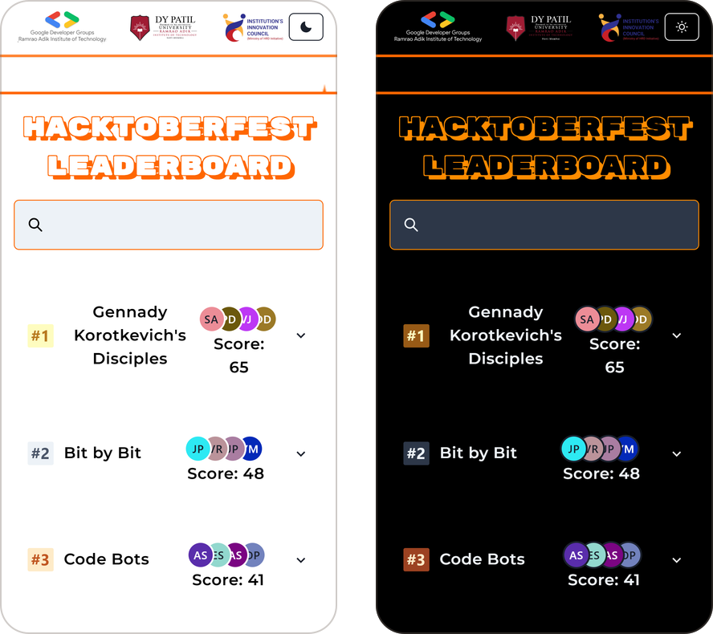
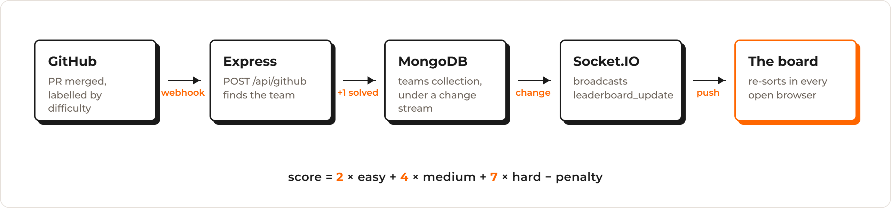

<div align="center">



<br>
<br>

**The live scoreboard for GDG RAIT's Hacktoberfest 2024: a maintainer merges a pull request, and every open board re-ranks the teams on the spot.**

**[Live board](https://gdg-rait.vercel.app)** &nbsp;&nbsp;|&nbsp;&nbsp; **[Results view](https://gdg-rait.vercel.app/lb)**

</div>

---

## What you get

**A board that ranks itself.** 14 teams and 51 students from Ramrao Adik Institute of Technology, sorted by score, with gold, silver and bronze badges for the top three. When a merged PR changes a score, the teams slide into their new places without a reload.



- **Click a team** to open it.
- **Type in the search bar** to filter by team name, member name or GitHub username.
- **Hit the moon** in the header for dark mode. The orange particle background runs in both.

<table>
<tr>
<td width="52%" valign="top">

</td>
<td valign="top">

- **Rank and score**: the badge, the team name, everyone's avatars and the score, on one row.
- **Team members**: each member with their initials avatar.
- **Problems solved**: how many hard problems the team landed.
- **GitHub username**: the account whose merged PRs count for the team.

</td>
</tr>
</table>

**Search as you type.** The list narrows with every key, and the ranks stay the team's real ranks, so `#7` is still seventh overall.



**A results view for the projector.** `/lb` drops the search bar and shows the top five, a break, then the bottom three outlined in red: the order you announce results in.

<table>
<tr>
<td width="60%" valign="top">

</td>
<td valign="top" align="center">

<br><sub>On a phone, in both themes</sub>
</td>
</tr>
</table>

## Run it

The board today is a static snapshot of the final standings, read from `src/FINAL-LIST.json`, so the frontend runs on its own:

```bash
git clone https://github.com/Deeptanshuu/gdsc-leaderboard.git
cd gdsc-leaderboard/gdsc-leaderboard
npm install
npm run dev
```

Open http://localhost:5173.

## Use

| Where | What it does |
| --- | --- |
| `/` | The full board, with search and team details |
| `/lb` | The results view: top five and bottom three |
| Moon / sun button | Switch between light and dark mode |
| Search bar | Filter by team, member or GitHub username |

## How it scores



During the event, a merged PR travelled from GitHub to every screen in five steps.

- **The label sets the points.** Each event PR carried `easy` (2 points), `medium` (4) or `hard` (7).
- **The webhook finds the team.** GitHub sends the `pull_request` event to `POST /api/github`. On a merge, the server matches the PR author to a team's GitHub username and skips disqualified teams.
- **MongoDB counts it.** The team's `problems_solved.<difficulty>` goes up by one.
- **A change stream spreads it.** The server watches the teams collection, recomputes every score on each write, and broadcasts `leaderboard_update` over Socket.IO.
- **The board re-sorts.** Each open browser re-ranks the list, and Framer Motion animates the moves.

**Score** is `easy × 2 + medium × 4 + hard × 7 − penalty`. A negative penalty works as a bonus.

## Live mode

To run it live again you need a MongoDB replica set (Atlas works; change streams need one) with a teams collection shaped like the entries in `FINAL-LIST.json`.

Create `Server/.env`:

```bash
MONGODB_URI=<connection string; the database name is GDSC-1>
TABLE_NAME=<the teams collection>
PORT=5000
```

Build the board, since the server serves `gdsc-leaderboard/dist`, then start the server:

```bash
npm --prefix gdsc-leaderboard install
npm --prefix gdsc-leaderboard run build
cd Server && npm install && npm start
```

Expose the port with a tunnel such as `ngrok http 5000`, and add a webhook to each event repository: payload URL `https://<tunnel>/api/github`, content type `application/json`, **Pull requests** events. On the board, set `VITE_API_ENDPOINT` in `gdsc-leaderboard/.env` and uncomment the Socket.IO block in `App.jsx`.

During the event the server ran on AWS behind Nginx with a DuckDNS domain, and the board deployed to Vercel, where `vercel.json` rewrites `/lb` to the app.

## Develop

| Command | What it does |
| --- | --- |
| `npm run dev` | Vite dev server on port 5173 |
| `npm run build` | Production build into `dist/` |
| `npm run preview` | Serve the production build |
| `npm run lint` | ESLint |

Run them in `gdsc-leaderboard/`. In `Server/`, `npm run dev` starts the server under nodemon.

The board is **React 18** on **Vite 5** with **Chakra UI**, **Framer Motion** and **particles.js**. The server is **Express 4** with **Socket.IO 4**, **Helmet** and the **MongoDB** driver. The board lives in `gdsc-leaderboard/src/` (`App.jsx`, `LeaderBoard.jsx` for `/lb`, `Header.jsx`). The webhook is in `Server/controllers/githubController.js`, scoring in `Server/services/teamService.js`, and the change stream in `Server/services/websocketManager.js`.

## Status

The event closed in October 2024, and the board shows the final standings. The server is kept as it ran, with three things to fix before reusing it:

- `getDifficultyAndPoints()` in `Server/utils/helpers.js` returns the whole points table, while `githubController.js` still expects `{ difficulty, points }` for a PR's labels.
- `app.get('/*')` in `server.js` is registered before `/api/leaderboard`, so that route returns the page instead of JSON.
- The `SIGINT` handler clears `broadcastInterval`, which is commented out.
