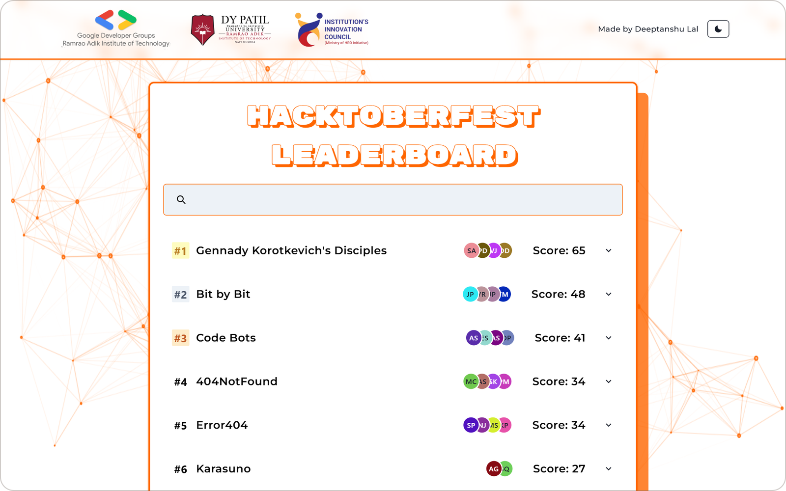

<div align="center">


</div>

<br>

The leaderboard for **GDG RAIT's Hacktoberfest 2024** event at Ramrao Adik Institute of Technology. 14 teams and 51 students raised pull requests against event repositories. Every merged PR earned points by difficulty, and the board re-ranked itself in every open browser the moment a PR was merged.

During the event a GitHub webhook fed an Express server, MongoDB stored the scores, and Socket.IO pushed each change to the React board. Once the event closed, the final standings were frozen into `FINAL-LIST.json` and the frontend became a static site on Vercel.



## What's on the board

| | |
| --- | --- |
| **Live ranking** | Teams sorted by score, with gold, silver and bronze badges for the top three |
| **Team details** | Open a team to see its members, hard problems solved and GitHub username |
| **Search** | Filter by team name, member name or GitHub username as you type |
| **Results view** | `/lb` shows the top five and the bottom three, for announcing results on a projector |
| **Light and dark** | Theme toggle in the header, with an animated particle background in both |
| **Phones** | Scores stack under the avatars and the card goes full width on small screens |

<table>
<tr>
<td width="50%"></td>
<td width="50%"></td>
</tr>
<tr>
<td align="center">A team opened in dark mode</td>
<td align="center">Searching for "code"</td>
</tr>
<tr>
<td width="50%"></td>
<td width="50%" align="center"></td>
</tr>
<tr>
<td align="center">The <code>/lb</code> results view</td>
<td align="center">On a phone</td>
</tr>
</table>

## How it works


1. A maintainer merges a pull request that carries an `easy`, `medium` or `hard` label.
2. GitHub sends the `pull_request` event to `POST /api/github`. The server looks up the team by the PR author's GitHub username and ignores disqualified teams.
3. The team's `problems_solved.<difficulty>` count goes up by one in MongoDB.
4. A change stream on the teams collection sees the write. The server recomputes every score and broadcasts `leaderboard_update` over Socket.IO.
5. Every open board re-sorts, and Framer Motion slides the teams into their new places.

Points per merged PR:

| Label | Points |
| --- | --- |
| `easy` | 2 |
| `medium` | 4 |
| `hard` | 7 |

A team's score is the sum of its points minus its `penalty`. A negative penalty works as a bonus.

## Tech stack

- **React 18** with **Vite 5**, **Chakra UI** (components and colour mode), **Framer Motion** (re-ranking animation), **React Router**, **Tailwind CSS**
- **particles.js** for the background
- **Node.js** and **Express 4**, with **Helmet** and **CORS**
- **Socket.IO 4** for the live updates, with a per-socket rate limiter (`rate-limiter-flexible`)
- **MongoDB** with change streams (needs a replica set, so Atlas or a local replica set)
- **Vercel** for the frontend

## Quick start

You need **Node.js 18** or newer.

The board as it stands today is static and reads the final standings from `src/FINAL-LIST.json`, so the frontend runs on its own:

```bash
git clone https://github.com/Deeptanshuu/gdsc-leaderboard.git
cd gdsc-leaderboard/gdsc-leaderboard
npm install
npm run dev
```

Open http://localhost:5173 for the board and http://localhost:5173/lb for the results view.

### Running the live server

The server is the real-time setup used during the event. It needs a MongoDB database with a collection of teams shaped like the entries in `FINAL-LIST.json`.

```bash
cd Server
npm install
```

Create `Server/.env`:

```bash
MONGODB_URI=<connection string; the database name is GDSC-1>
TABLE_NAME=<the teams collection>
PORT=5000
```

Build the frontend first, since the server serves `gdsc-leaderboard/dist`, then start it:

```bash
npm --prefix ../gdsc-leaderboard run build
npm start
```

To receive webhooks on your machine, expose the port with a tunnel such as `ngrok http 5000`. Then add a webhook on each event repository with the payload URL `https://<tunnel>/api/github`, content type `application/json`, and the **Pull requests** event.

The board connects to the server through `VITE_API_ENDPOINT` in `gdsc-leaderboard/.env`. The socket code in `App.jsx` and `LeaderBoard.jsx` is commented out in the static build; uncomment it to go live again.

## Scripts

Run these in `gdsc-leaderboard/`:

| Command | What it does |
| --- | --- |
| `npm run dev` | Start the Vite dev server on port 5173 |
| `npm run build` | Production build into `dist/` |
| `npm run preview` | Serve the production build |
| `npm run lint` | ESLint |

In `Server/`, `npm start` runs the server and `npm run dev` runs it with nodemon.

## Project layout

```
gdsc-leaderboard/          React frontend
  src/App.jsx              the board: ranking, search, team details
  src/LeaderBoard.jsx      /lb results view: top five and bottom three
  src/Header.jsx           logos and the theme toggle
  src/Theme.jsx            Chakra theme and colour mode
  src/FINAL-LIST.json      final standings, read by the static build
  public/                  logos and favicon
  vercel.json              rewrites /lb to the SPA
Server/                    Express + Socket.IO backend
  server.js                routes, static files, startup
  controllers/             GitHub webhook and leaderboard handlers
  services/teamService.js  team lookup, point updates, score calculation
  services/websocketManager.js  Socket.IO server and the MongoDB change stream
  utils/helpers.js         points per difficulty
  config/database.js       MongoDB connection
docs/images/               README images
```

## Deployment

The frontend deploys to Vercel from `gdsc-leaderboard/`. `vercel.json` rewrites `/lb` to `index.html` so the results view works on a direct visit.

During the event the server ran on AWS behind Nginx, with a DuckDNS domain. That setup has since been retired. `Server/vercel.json` holds a Vercel config for the server, but Socket.IO and change streams need a long-running process, so a VM or a container host suits it better.

## Status

The event ended in October 2024 and the board now shows the final standings. The server code is kept as it ran, with a few rough edges to fix before reusing it:

- `getDifficultyAndPoints()` in `Server/utils/helpers.js` now returns the whole points table, while `githubController.js` still expects `{ difficulty, points }` for a PR's labels.
- `app.get('/*')` in `server.js` is registered before `/api/leaderboard`, so that route returns the SPA instead of JSON.
- The `SIGINT` handler clears `broadcastInterval`, which is commented out.
